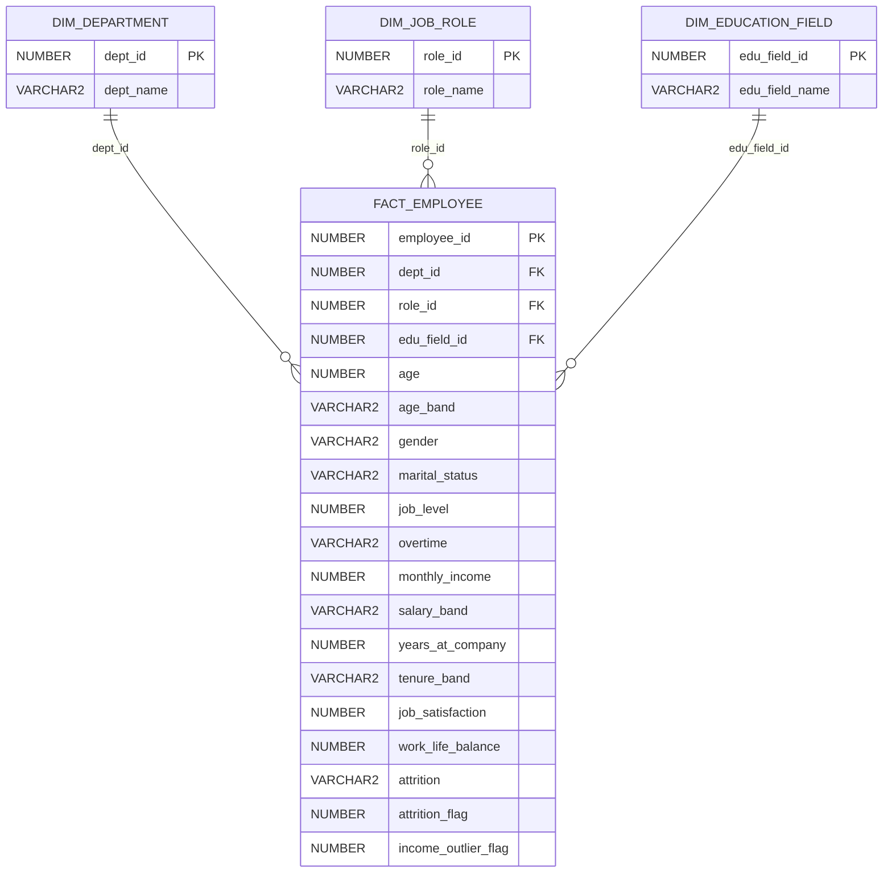

# Star Schema

The clean CSV is loaded into a staging table, then split into one fact table and three dimension
tables. Bands (tenure, salary, age) stay on the fact table as attributes because each one comes
from a single column of the fact row.



Data flow:

```
Kaggle CSV ──► Python (clean, band, flag) ──► hr_attrition_clean.csv
          ──► SQL*Loader ──► STG_HR_EMPLOYEE ──► DIM_* + FACT_EMPLOYEE ──► VW_* views ──► Power BI
```

*GitHub renders the Mermaid block as a diagram. For the report, paste it into https://mermaid.live
and export a PNG, or use SQL Developer → File → Data Modeler → Import → Data Dictionary.*
